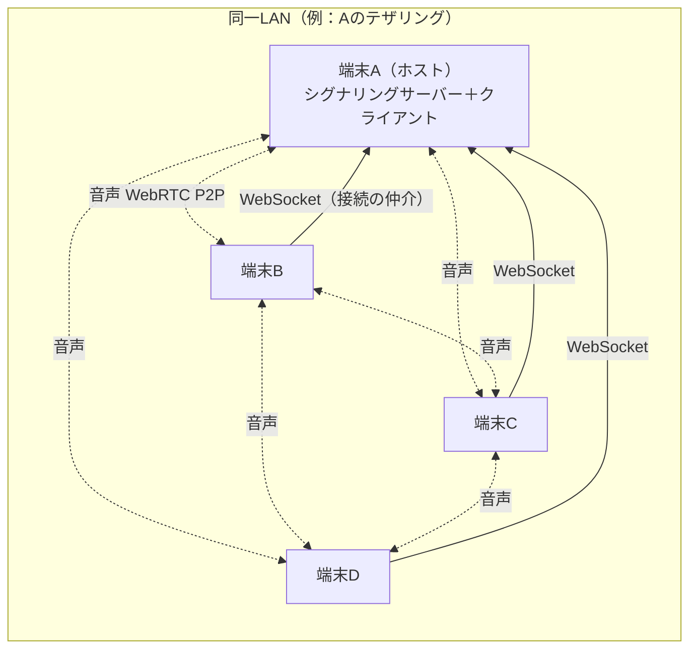
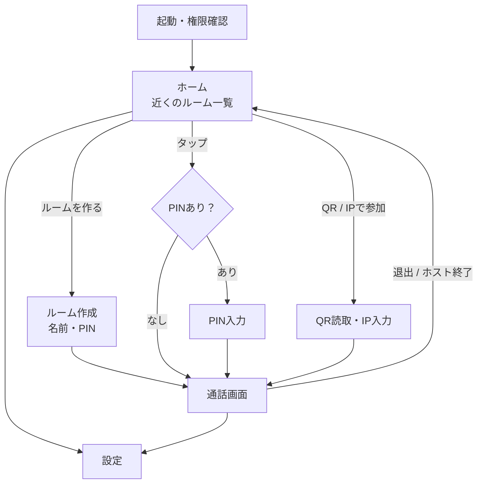
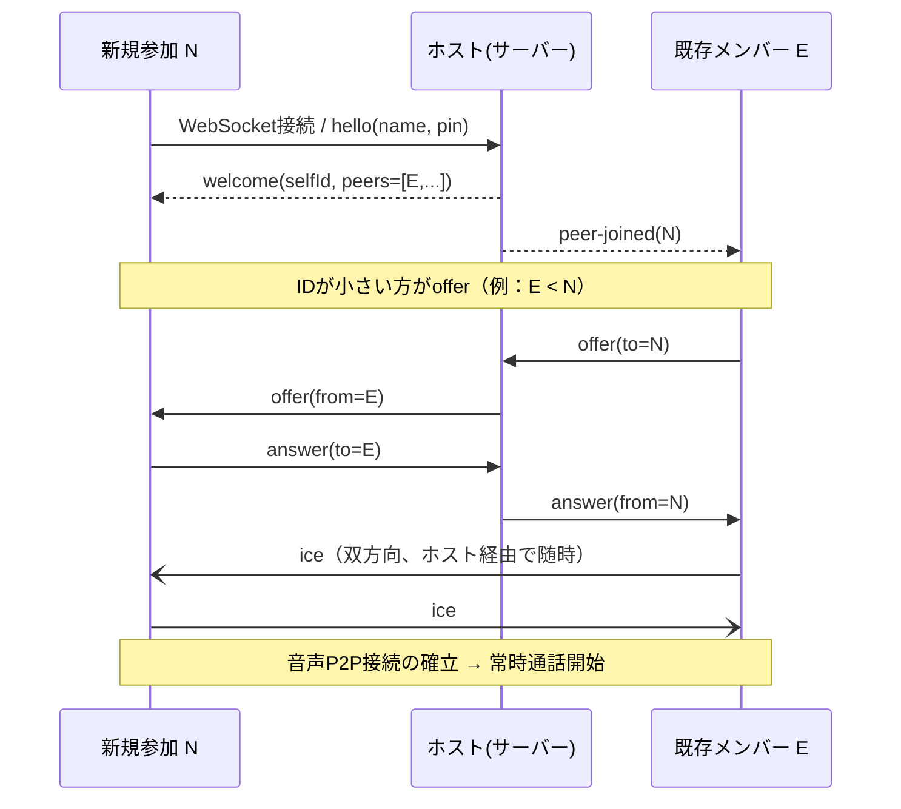
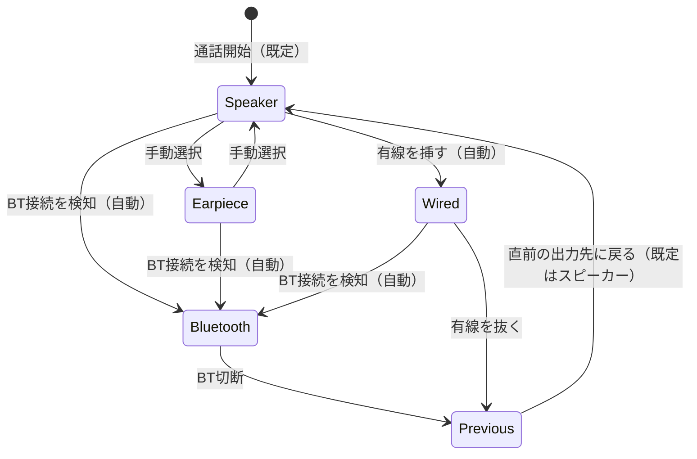

# 方式設計書（MVP）

| 項目 | 内容 |
|---|---|
| 版 | v0.2（2026-10-11） |
| 対応する要件 | [requirements_definition.md](requirements_definition.md) |

---

## 1. 全体構成



| 役割 | 方式 | 補足 |
|---|---|---|
| ネットワーク | **同一LAN（IPv4）のみを前提** | テザリング／Wi-Fiルーター／将来の中継機のどれでも動く |
| ルームの検出 | **mDNS / DNS-SD**（`_intercom._tcp`） | 見つからない場合は QRコード / IP直接入力 |
| シグナリング（接続の仲介） | **ホスト端末内で動くWebSocketサーバー** | ホスト自身も `127.0.0.1` で自分のサーバーに接続する（全端末で処理を共通化） |
| 音声 | **WebRTC フルメッシュ（Opus）** | 4人で6本の接続。サーバーを経由しない |
| 暗号化 | DTLS-SRTP（WebRTC標準） | 追加実装なし |

## 2. 技術スタック

| 区分 | 採用 | 用途 |
|---|---|---|
| フレームワーク | Flutter（Dart） | Android先行、将来iOS |
| WebRTC | `flutter_webrtc` | 音声通話・音声処理（AEC/NS/AGC）・出力切替 |
| 検出 | `nsd` | mDNSでルームの公開・検出 |
| シグナリング | `dart:io`（`HttpServer` + `WebSocketTransformer`）／`web_socket_channel` | サーバー／クライアント |
| 状態管理 | `flutter_riverpod` | |
| 画面遷移 | `go_router` | |
| 設定保存 | `shared_preferences` | 表示名・色・音声設定 |
| QR | `qr_flutter`（表示）、`mobile_scanner`（読取） | |
| 常駐 | Foreground Service（`flutter_foreground_task` または Kotlin自作） | 画面OFF時の通話継続 |
| 権限 | `permission_handler` | |

> [!NOTE]
> 出力先の切り替えは、まず `flutter_webrtc` 内蔵の機能（Android版は内部でTwilioの `audioswitch` を使用）で実装します。
> Bluetooth の自動切替が不十分な場合だけ、Kotlinで `AudioManager.setCommunicationDevice()`（API 31+）／`startBluetoothSco()`（API 30以下）を呼ぶプラットフォームチャネルを追加します（→ 検証項目 R4）。

## 3. 画面設計（Discord風）

### 3.1 画面遷移



### 3.2 各画面

**ホーム**
- 上部：自分のアイコン＋表示名（タップで設定へ）
- 中央：**近くのルーム一覧**（ルーム名、`2/4人`、🔒PIN有無）。自動で更新
- 下部：大きな「＋ ルームを作る」ボタン、「QR / IPで参加」
- 一覧が空のときは「同じWi-Fi／テザリングにつながっていますか？」と案内する

**通話画面**（グローブでも押せる大きさにする）
```
┌─────────────────────────┐
│ ツーリング部屋   3/4  [QR] │ ← QRで招待を表示
├─────────────────────────┤
│   ┌────┐    ┌────┐      │
│   │ 🟢A │    │ B  │      │ ← 話している人は輪が光る
│   └────┘    └────┘      │   長押しで個別音量
│   ┌────┐                │
│   │ C🔇│                │ ← ミュート中アイコン
│   └────┘                │
├─────────────────────────┤
│ [🎤]  [🎧]  [🔊BT]  [📞退出]│ ← 72dp目安
└─────────────────────────┘
  ミュート スピーカー 出力先   退出（赤）
          ミュート
```
- 出力先ボタンを押すと、ボトムシートに使える機器の一覧（スピーカー / 受話口 / 有線 / Bluetooth機器名）が出て、選んだものにチェックが付く

**設定**（Discordの「ユーザー設定 > 音声・ビデオ」に相当）
| セクション | 項目 |
|---|---|
| プロフィール | 表示名、アイコン色 |
| 出力 | 既定の出力先、出力音量 |
| 入力 | 入力音量、入力感度（自動／手動しきい値スライダー）、マイクテスト（レベルメーター） |
| 音声処理 | ノイズ抑制、エコー除去、自動ゲイン（すべて既定ON） |
| 通知 | 入退室の効果音 |

## 4. ルームの検出（mDNS）

- ホストはルーム作成時にサービスを登録する
  - サービス種別：`_intercom._tcp`
  - ポート：`47800`（使用中なら空きポートを選んで登録）
  - TXTレコード：

| キー | 例 | 意味 |
|---|---|---|
| `v` | `1` | プロトコルのバージョン |
| `rid` | `a1b2c3` | ルームID（ランダム） |
| `name` | `ツーリング部屋` | ルーム名（UTF-8） |
| `n` | `2` | 現在の人数 |
| `max` | `4` | 定員 |
| `pin` | `1` / `0` | PINの有無 |

- 人数が変わったら登録し直して `n` を更新する
- 参加者側はホームを開いている間だけ検出を行う（電池節約）
- **QRコードの中身**：`intercom://join?h=192.168.43.1&p=47800&rid=a1b2c3`

## 5. シグナリング設計

### 5.1 基本ルール

- 通信路：`ws://<ホストIP>:<port>/ws`。中身はJSONテキスト
- ホストは **受付と中継だけ** を行う。音声は端末同士で直接やり取りする
- **offerを出すのは「peerIdが小さい方」** に固定する（同時にoffer（glare）が出ないようにするため。再接続時も同じルール）
- peerId は参加時にホストが発行する（UUID v4）

### 5.2 メッセージ一覧

| type | 方向 | 主な項目 | 内容 |
|---|---|---|---|
| `hello` | C→H | `v`, `name`, `color`, `pin?`, `resumeId?` | 参加要求 |
| `welcome` | H→C | `selfId`, `room{rid,name}`, `peers[]` | 参加OK。今いるメンバー一覧 |
| `reject` | H→C | `reason`（`full` / `pin` / `version`） | 参加拒否 |
| `peer-joined` | H→全員 | `peer{id,name,color,muted,deafened}` | 新メンバー |
| `peer-left` | H→全員 | `id` | 退出 |
| `offer` / `answer` | C→H→C | `to` / `from`, `sdp` | WebRTCの接続条件交換（ホストが `from` を付けて転送） |
| `ice` | C→H→C | `to` / `from`, `candidate` | 経路候補 |
| `state` | C→H→全員 | `muted`, `deafened` | ミュート状態の共有 |
| `ping` / `pong` | 双方向 | `t` | 生存確認（2秒ごと、6秒応答なしで切断扱い） |
| `leave` | C→H | — | 退出 |
| `room-closed` | H→全員 | `reason` | ホストが終了 |

### 5.3 参加シーケンス



### 5.4 切断と再接続（N-03：5秒以内に復帰）

| 事象 | 対応 |
|---|---|
| WebSocketが切れた（参加者側） | 0.5s → 1s → 2s → 2s…の間隔で再接続。`hello` に `resumeId`（前回のselfId）を付ける |
| ホスト側 | 切断から **30秒間は枠を確保**。`resumeId` が一致すれば同じIDで復帰させる。30秒過ぎたら `peer-left` |
| 音声のP2P接続が `disconnected` | 2秒待っても戻らなければ、IDが小さい方が **ICE restart**（offerを出し直す） |
| P2P接続が `failed` | 接続を作り直す |
| ホストに30秒つながらない | 「ルームが終了しました」としてホームへ戻る |

## 6. 音声（メディア）設計

### 6.1 WebRTC 設定

```dart
final config = {
  'iceServers': [],              // STUN/TURNは使わない（LAN内のアドレスだけで接続）
  'sdpSemantics': 'unified-plan',
  'bundlePolicy': 'max-bundle',
};
final mediaConstraints = {
  'audio': {
    'echoCancellation': true,    // 設定で切替
    'noiseSuppression': true,    // 設定で切替（風切り音対策）
    'autoGainControl': true,     // 設定で切替
  },
  'video': false,
};
```

### 6.2 Opus パラメータ（SDPを書き換えて指定）

| パラメータ | 値 | 理由 |
|---|---|---|
| `maxaveragebitrate` | `32000` | 声には十分。LAN内なので余裕あり |
| `stereo` | `0` | モノラル |
| `useinbandfec` | `1` | パケットが失われても補う（Wi-Fiの揺らぎ対策） |
| `usedtx` | `1` | 無音時の送信を減らす（電池・帯域節約） |
| `ptime` | `20` | 標準。遅延が気になれば `10` を試す |

### 6.3 各機能の実現方法

| 機能 | 実現方法 |
|---|---|
| ミュート (F-11) | 自分の音声トラックを `enabled = false` |
| スピーカーミュート (F-12) | 相手の全トラックを無効化＋自分もミュート |
| 個別音量 (F-13) | `Helper.setVolume(倍率, 相手のトラック)`。設定はpeerの表示名ごとに保存 |
| 話者表示 (F-14) | `getStats()` の `audioLevel`（相手：inbound-rtp／自分：media-source）を200msごとに取得。しきい値を超えたら光らせる |
| 入力感度・ノイズゲート (F-33) | 自分の `audioLevel` がしきい値未満の状態が500ms続いたら送信停止、超えたら即再開 |
| 効果音 (F-16) | 通話用の音声経路で短い音を鳴らす（ヘッドセットから聞こえるように） |

### 6.4 出力先の切り替え（F-20〜F-24）



- Androidの通話モード（`MODE_IN_COMMUNICATION`）で動かす。Bluetoothヘッドセットは **HFP（通話用の接続方式）** になる
- 機器の一覧は `enumerateDevices()` の `audiooutput` から取り、選んだら `Helper.selectAudioOutput(deviceId)` を呼ぶ

> [!WARNING]
> Bluetoothヘッドセットを通話で使うとHFPになり、**音楽を聴くとき（A2DP）より音質が下がります**（端末とヘッドセットの組み合わせ次第で8kHzまたは16kHz）。これはBluetoothの仕様上の制約で、アプリ側では変えられません。

### 6.5 通信品質の計測（要件 Q-01〜Q-04 / F-50）

1秒ごとに取得し、開発中はログに出力する（F-50を実装する場合は画面にも表示する）。

| 指標 | 取得方法 | 単位 | 備考 |
|---|---|---|---|
| Q-01 RSSI | Android `WifiInfo.getRssi()`（API 31以上は `NetworkCapabilities.getTransportInfo()` 経由）。プラットフォームチャネルで取得 | dBm | **テザリング親機側では取得できない**（親機はAPなので）。参加者側の値を使う |
| Q-02 RTT | `getStats()` の `candidate-pair`（`nominated`）の `currentRoundTripTime` | 秒→msに変換 | 相手ごとに取得 |
| Q-03 欠落率 | `inbound-rtp`（audio）の `packetsLost` と `packetsReceived` の **前回との差分** から算出 | % | 累計値ではなく直近1秒の値を使う |
| Q-04 ジッター | `inbound-rtp`（audio）の `jitter` | 秒→msに変換 | |
| （参考）受信バッファ遅延 | `jitterBufferDelay` ÷ `jitterBufferEmittedCount` | ms | 片道遅延（N-01）を見積もるときの参考 |
| （参考）リンク速度 | `WifiInfo.getLinkSpeed()` | Mbps | 電波状態の補助指標 |

- ログの形式（1行＝1秒）：`time, peerId, rssi, rttMs, lossPct, jitterMs, jbDelayMs, linkMbps`
- CSVで端末内に保存できるようにしておくと、距離テスト（§11.1）の集計が楽になる

## 7. バックグラウンド動作（F-40, F-41）

| 対策 | 内容 |
|---|---|
| Foreground Service | 通話中は常駐通知を出す。`foregroundServiceType="microphone"`（Android 14以降は必須） |
| 通知の操作 | 通知に「ミュート」「退出」ボタンを付ける |
| Wi-Fiの省電力対策 | `WifiLock`（API 29以上は `WIFI_MODE_FULL_LOW_LATENCY`）で、省電力による遅延の増加を防ぐ |
| CPUの停止防止 | `PARTIAL_WAKE_LOCK` |
| 電池の最適化 | 初回に「電池の最適化の対象外」にするよう案内する（機種ごとの強制終了対策） |
| mDNS | `MulticastLock` を取得する |

### 7.1 必要な権限（AndroidManifest）

| 権限 | 用途 |
|---|---|
| `RECORD_AUDIO` | マイク |
| `MODIFY_AUDIO_SETTINGS` | 出力先の切り替え |
| `BLUETOOTH_CONNECT` | BTヘッドセット（Android 12以降） |
| `INTERNET`, `ACCESS_NETWORK_STATE`, `ACCESS_WIFI_STATE` | 通信 |
| `CHANGE_WIFI_MULTICAST_STATE` | mDNS |
| `WAKE_LOCK` | 常駐 |
| `FOREGROUND_SERVICE`, `FOREGROUND_SERVICE_MICROPHONE` | 常駐（Android 14以降） |
| `POST_NOTIFICATIONS` | 常駐通知（Android 13以降） |
| `CAMERA` | QR読取（使うときだけ要求） |

## 8. ディレクトリ構成（予定）

```
intercom_App/
├─ docs/
└─ app/                          # Flutterプロジェクト
   ├─ lib/
   │  ├─ main.dart
   │  ├─ app/                    # ルーティング・テーマ
   │  ├─ features/
   │  │  ├─ home/                # ルーム一覧・作成・参加
   │  │  ├─ room/                # 通話画面
   │  │  └─ settings/            # 設定
   │  └─ core/
   │     ├─ signaling/           # protocol.dart / server.dart / client.dart
   │     ├─ discovery/           # mDNSでの公開・検出
   │     ├─ media/               # peer_manager.dart / audio_route.dart / voice_activity.dart
   │     ├─ background/          # Foreground Service
   │     └─ storage/             # 設定の保存
   ├─ android/                   # 必要ならKotlinのプラットフォームチャネル
   └─ test/                      # シグナリング等の単体テスト
```

## 9. 開発環境（Windows + Android実機）

| 項目 | 内容 |
|---|---|
| 必要なもの | Flutter SDK、Android Studio（SDKとplatform-toolsだけ使う。**エミュレータは入れない**）、Android実機2台以上 |
| 端末の準備 | 開発者オプション → USBデバッグをON |
| 2台同時に動かす | 1台はUSB、もう1台は **ワイヤレスデバッグ**（`adb pair` → `adb connect`）にすると楽 |
| 実行 | `flutter devices` で確認 → `flutter run -d all`（全台に同時インストール・起動） |
| ネットワーク | 開発中は自宅Wi-Fi（S4）。実走前にテザリング（S1/S2）で確認 |

### 9.1 検証端末

| 端末 | Wi-Fi | Bluetooth | 役割 | 備考 |
|---|---|---|---|---|
| Google Pixel 8a | Wi-Fi 6E | 5.3 | **ホスト＋テザリング親機** | テザリングは「互換性を拡張」ON（2.4GHz、距離優先） |
| OPPO Reno3 A | Wi-Fi 5 | 5.0 | 参加者 | Androidのバージョンを要確認（ワイヤレスデバッグはAndroid 11以上） |

## 10. マイルストーン

| # | 内容 | 完了条件 | 状況 |
|---|---|---|---|
| M0 | 環境構築 | 実機2台にサンプルアプリが入る | ✅ 達成（Pixel 8a, Reno3 A） |
| M1 | **1対1通話**（IP直接入力・同じWi-Fi） | 2台で常時通話でき、遅延200ms以下を体感で確認 | 次に着手 |
| M2 | ルーム作成・自動検出・QR参加・Discord風UI | ホームの一覧からタップで参加できる | 未着手 |
| M3 | 4人メッシュ・話者表示・ミュート・個別音量 | 3〜4台で同時に通話できる | 未着手 |
| M4 | 出力先の切り替え・BT自動切替 | ヘッドセットの接続・切断で自動的に切り替わる | 未着手 |
| M5 | バックグラウンド継続・自動再接続 | 画面OFFで30分継続、Wi-Fiを切って戻すと復帰する | 未着手 |
| M6 | **テザリング＋実走テスト** | S1/S2のシーンで実用になるかを評価する | 未着手 |

## 11. 検証項目（リスク）

実装を進める中で確認し、結果をこの表に追記する。

| # | 確認すること | 問題だった場合の対策 |
|---|---|---|
| R1 | テザリング親機（ホスト）でmDNSの公開・検出ができるか | QR / IP入力で参加。ホストIPを画面に大きく表示する |
| R2 | テザリングの接続端末どうしが直接通信できるか（クライアント分離がないか） | 機種を変える／Wi-Fiルーター利用 |
| R3 | インターネットの無いWi-Fiで、端末が勝手にWi-Fiを切らないか | 「インターネット未接続でも接続を維持」の設定を案内する |
| R4 | `flutter_webrtc` 内蔵機能だけでBT自動切替が安定するか | Kotlinのプラットフォームチャネルを自作する |
| R5 | 画面OFF時にWi-Fi省電力で遅延が増えないか | WifiLockの種類を変える |
| R6 | 接続端末がいないとテザリングが自動OFFになる機種がないか | 「自動OFF」を無効にするよう案内する |
| R7 | 4人メッシュ時のCPU使用率・電池消費 | ビットレートを下げる／DTXの効果を確認する |
| R8 | 走行中の風切り音に対して、ノイズ抑制が十分に効くか | ノイズゲートのしきい値を調整する／ヘッドセットのマイクを推奨する |
| R9 | 実用距離（Q-05）が想定シーンに足りるか（§11.1） | 2.4GHz固定・端末の保持位置を変える／将来の中継機（HaLow等）を検討 |

### 11.1 距離テスト（Q-05 実用距離の測定）

**手順**
1. Pixel 8aでテザリングを開始し、ホストとしてルームを作る。Reno3 Aが参加する
2. 開けた場所で、一方を固定してもう一方が **10mごと** に離れ、各地点で30秒ずつ通話する
3. 各地点で Q-01〜Q-04 の中央値と、聞こえ方（◎/○/△/✕）を記録する
4. 総合評価が🔴になったら終了。その手前の距離を実用距離とする

**条件の組み合わせ**（体による遮断の影響を切り分けるため）

| # | 保持位置 | 周波数帯 | 実用距離 | メモ |
|---|---|---|---|---|
| T1 | 両方とも手に持つ（見通しあり） | 2.4GHz | 未測定 | 理想条件の上限 |
| T2 | 両方とも上着のポケット | 2.4GHz | 未測定 | 走行時に近い条件 |
| T3 | タンクバッグ／スマホホルダー | 2.4GHz | 未測定 | バイクに取り付けた条件 |
| T4 | 両方とも手に持つ | 5GHz | 未測定 | 周波数帯による差の確認 |
